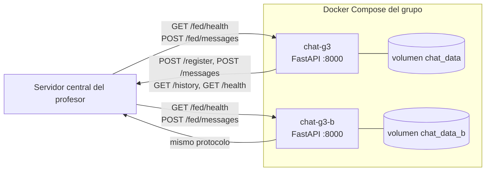

# Chat distribuido en estrella — grupo `g3`

**Equipo:** Emerson, Daniela, Nataly y Mariana.
**Repositorio:** <https://github.com/ILOHU-cmd/proyecto-final-sd>

Proyecto final de **Sistemas Distribuidos** (UIS · EISI). Cada grupo levanta un
servidor de chat que se conecta al servidor central del curso. Todos los
usuarios del curso conversan en una única sala global, `#general`, y el
sistema completo se comporta como un solo chat distribuido.

> **Reparto de trabajo:** el detalle de quién es dueño de cada módulo, rama y
> entregable está en [`PLAN_EQUIPO.md`](PLAN_EQUIPO.md). Este README explica el
> sistema; el plan explica cómo lo trabaja el equipo sin generar conflictos.

Este repositorio contiene el **mínimo común funcional**: usuarios locales,
persistencia, cliente de consola, registro en el central, envío/recepción,
reloj de Lamport, deduplicación, reintentos con backoff, heartbeat,
recuperación de historial, Docker y el script del experimento de fallos.

> Este README está pensado también como guion de estudio para la sustentación.
> Cada decisión técnica incluye el *porqué* y la sección 8 resume las
> respuestas a las preguntas más probables del profesor.

---

## 1. Arquitectura

```text
                         +-----------------------------------+
                         |   Servidor central (profesor)     |
                         |                                   |
                         |  POST /register                   |
                         |  POST /messages                   |
                         |  GET  /history?since={lamport}    |
                         |  GET  /health                     |
                         +----------------+------------------+
                                          |
             +----------------------------+----------------------------+
             |                            |                            |
      +------v------+              +------v------+              +------v------+
      |   g1        |              |   g3        |              |   g4        |
      |  FastAPI    |              |  FastAPI    |              |  FastAPI    |
      |  SQLite     |              |  SQLite     |              |  SQLite     |
      |  volumen    |              |  volumen    |              |  volumen    |
      +-------------+              +-------------+              +-------------+
```

Los servidores de grupo **nunca se hablan directamente**. Todo mensaje pasa
por el central. Esa es la topología en estrella que exige el enunciado.

### Recorrido de un mensaje

1. `ana@g3` escribe desde el cliente CLI contra **su** servidor (`g3`).
2. `g3` incrementa su reloj de Lamport, genera el UUID, guarda el mensaje en
   SQLite y lo encola en la cola de salida (`outbox`).
3. La tarea de fondo envía `POST /messages` al central.
4. El central guarda el mensaje una sola vez y lo reenvía a `g1`, `g2`, `g4`
   (todos menos el origen) con el **mismo id** y la **misma marca de Lamport**.
5. Cada servidor receptor aplica `L = max(L, L_recibido) + 1`, deduplica por
   UUID y entrega el mensaje a sus clientes.
6. Si un servidor estaba caído, al volver pide `GET /history?since=...` y
   recupera lo perdido sin duplicar nada.

### Diagrama de contenedores, red y volúmenes



En el `docker-compose.yml` hay tres servicios:

| Servicio | Perfil | Para qué |
|---|---|---|
| `chat-g3` | siempre | Servidor del grupo (`g3`). |
| `chat-g3-b` | `pair` | Segundo servidor del mismo grupo (`g3b`), para probar sin depender de otros grupos. |
| `central` | `local` | **Central de prueba** en memoria, solo para desarrollo. No es el central del profesor. |

---

## 2. Cumplimiento del mínimo común

| Requisito del enunciado | Dónde se cumple |
|---|---|
| 1. Despliegue con `docker compose up` | `Dockerfile`, `docker-compose.yml` |
| 2. Persistencia tras `restart` | SQLite en volumen `/data`; tablas `users`, `messages`, `outbox`, `state` |
| 3. Usuarios locales | `POST /users`, `GET /users`, comando `create-user` |
| 4. Registro periódico | `ClienteCentral._bucle_registro` (`POST /register` cada 10 s) |
| 5. Envío y recepción | `POST /messages` local, `POST /fed/messages`, cola `outbox` |
| 6. Entrega al menos una vez | `outbox` persistente + reintentos + deduplicación por UUID |
| 7. Orden lógico | `app/lamport.py`; historial `ORDER BY lamport, origin, id` |
| 8. Detección de fallos | `GET /health` cada 5 s; tras 3 fallos se marca caído |
| 9. Recuperación de historial | `GET /history?since=...` al arrancar y al reconectar |
| 10. Cliente | `client/cli.py`, con colores y etiqueta de grupo |
| 11. Logs de auditoría | `app/logger.py`: `ENVÍO`, `RECEPCIÓN`, `REINTENTO`, `DESCARTE_DUPLICADO`, `CAÍDA_CENTRAL`, ... |

---

## 3. Inicio rápido

### 3.1 Requisitos

- Docker Engine 24+ y Docker Compose v2 (`docker compose version`).
- Para el cliente en el anfitrión: Python 3.10+ (recomendado 3.12) y
  `pip install httpx` (o `pip install -r requirements.txt`).
- Si se ejecuta todo sin Docker: `pip install -r requirements.txt`.

### 3.2 Modo local con central de prueba

Sirve para ver todo funcionando en un solo computador, sin depender del
profesor. El central de prueba guarda todo en memoria: si se reinicia, pierde
el historial (para el experimento de caída del servidor de grupo no importa,
porque el central permanece arriba).

```bash
cd chat-distribuido-g3
cp .env.example .env
docker compose --profile local up --build -d
docker compose logs -f chat-g3
```

Se levantan:

- `central` en `http://localhost:9000`
- `chat-g3` en `http://localhost:8001`

En otra terminal:

```bash
# Crear un usuario local
python client/cli.py --url http://localhost:8001 create-user ana

# Conversar (lee y escribe en vivo)
python client/cli.py --url http://localhost:8001 chat ana

# Ver el estado de la federación
python client/cli.py --url http://localhost:8001 status

# Leer el historial y salir
python client/cli.py --url http://localhost:8001 read
```

Si no quieres instalar `httpx` en el anfitrión, ejecuta el cliente dentro del
contenedor (ojo: dentro del contenedor el puerto es `8000`, no `8001`):

```bash
docker compose exec chat-g3 python client/cli.py --url http://localhost:8000 users
docker compose exec chat-g3 python client/cli.py --url http://localhost:8000 chat ana
```

Para detener todo (sin borrar los volúmenes):

```bash
docker compose down
```

Para probar con **dos servidores del mismo grupo** (recomendado para el
experimento y para la demo de caídas):

```bash
docker compose --profile local --profile pair up --build -d
```

- `chat-g3` → host `8001`
- `chat-g3-b` → host `8002` (grupo `g3b`)

```bash
python client/cli.py --url http://localhost:8002 create-user beto
python client/cli.py --url http://localhost:8002 chat beto
```

### 3.3 Modo curso, con el central del profesor

1. Averigua la IP de tu equipo en la red de la sala (`ip addr` o `ipconfig`).
2. Edita `.env`:

```dotenv
GROUP_NAME=g3
PUBLIC_URL=http://192.168.1.50:8001     # IP de TU equipo, puerto publicado
CENTRAL_URL=http://192.168.1.10:9000    # IP o URL del central del profesor
HOST_PORT=8001
```

3. Levanta el servidor:

```bash
docker compose up --build -d
docker compose logs -f chat-g3
```

4. En los logs deben aparecer, como mínimo:

```text
[g3] [REGISTRO_OK] servidor=g3 url=http://192.168.1.50:8001
[g3] [RECUPERACIÓN_OK] lamport=0 pendientes=0
```

**El error más común** es que el central no pueda alcanzar `PUBLIC_URL`.
Comprueba desde otro equipo de la red:

```bash
curl http://192.168.1.50:8001/fed/health
```

Debe responder algo como:

```json
{"server":"g3","lamport":12}
```

Si no responde, revisa el firewall y que `PUBLIC_URL` use la IP de la red, no
`localhost` ni el nombre `chat-g3` (ese nombre solo funciona dentro de la red
de Docker). Si la red de la sala no permite conexiones entrantes, se usa el
modo alternativo que anuncie el profesor.

Si también levantas `chat-g3-b` contra el central del profesor, cada servidor
necesita su propia URL alcanzable y un nombre distinto. En `.env`:

```dotenv
GROUP_NAME_B=g3b
PUBLIC_URL_B=http://192.168.1.50:8002
HOST_PORT_B=8002
```

Los dos se registran como servidores separados (`g3` y `g3b`).

### 3.4 Ejecución sin Docker (desarrollo)

```bash
python3.12 -m venv .venv
source .venv/bin/activate
pip install -r requirements.txt

# Terminal 1: central de prueba
python scripts/mock_central.py --port 9000

# Terminal 2: servidor g3
GROUP_NAME=g3 \
PUBLIC_URL=http://localhost:8001 \
CENTRAL_URL=http://localhost:9000 \
PORT=8001 \
DB_PATH=./data/g3.db \
uvicorn app.main:app --host 0.0.0.0 --port 8001
```

---

## 4. Cliente de consola

```bash
python client/cli.py [--url URL] [--no-color] COMANDO ...
```

| Comando | Ejemplo | Qué hace |
|---|---|---|
| `users` | `python client/cli.py users` | Lista usuarios locales. |
| `create-user` | `python client/cli.py create-user ana` | Crea `ana@g3`. |
| `send` | `python client/cli.py send ana "hola"` | Envía a `#general`. |
| `read` | `python client/cli.py read --since 0` | Imprime el historial local. |
| `read --follow` | `python client/cli.py read --follow` | Sigue leyendo mensajes nuevos. |
| `chat` | `python client/cli.py chat ana` | Modo interactivo con lectura en vivo. |
| `status` | `python client/cli.py status` | Estado del central, reloj y pendientes. |

La salida distingue los mensajes propios (cian) de los de otros grupos
(amarillo) y muestra la marca de Lamport:

```text
[L=  42] [  g3] ana@g3                   ¿Ya subieron el compose?
[L=  43] [  g1] carlos@g1                Sí, ya está en el repo.
```

Dentro de `chat`: `/usuarios` lista los usuarios y `/salir` termina.

---

## 5. API

### 5.1 API local (cliente ↔ nuestro servidor)

Esta API es libre según el enunciado. Se mantuvo pequeña para que la demo sea
clara.

| Método y ruta | Cuerpo | Respuesta |
|---|---|---|
| `GET /` | — | Nombre, URLs y reloj. |
| `GET /health` | — | Salud del propio servidor. |
| `GET /status` | — | Central en línea/caído, pendientes, usuarios. |
| `POST /users` | `{"username":"ana"}` | `201` con `{"username":"ana","identity":"ana@g3"}`. `409` si existe. |
| `GET /users` | — | Lista de usuarios locales. |
| `POST /messages` | `{"user":"ana","body":"hola"}` | `201` con el mensaje completo (ya guardado y encolado). |
| `GET /messages?since=0&limit=500` | — | `{"messages":[...]}` ordenado por `(lamport, origin, id)`. |

Ejemplos:

```bash
curl -X POST http://localhost:8001/users \
  -H 'Content-Type: application/json' \
  -d '{"username":"ana"}'

curl -X POST http://localhost:8001/messages \
  -H 'Content-Type: application/json' \
  -d '{"user":"ana","body":"hola a todos"}'

curl 'http://localhost:8001/messages?since=0'
```

### 5.2 API federada (central ↔ nuestro servidor)

| Método y ruta | Propósito |
|---|---|
| `GET /fed/health` | Heartbeat. Responde `{"server":"g3","lamport":42}`. |
| `POST /fed/messages` | Recibe un mensaje reenviado por el central. **Idempotente**. |

Si el `id` ya existe, `POST /fed/messages` responde `200` con
`{"status":"duplicate","duplicate":true}` y **no modifica nada**: ni el
historial ni el reloj. Un reintento no es un evento nuevo.

### 5.3 Formato del mensaje

```json
{
  "id": "6f1c2a9e-4b7d-4f0e-9a51-2c8e7d3b1f44",
  "from": "ana@g3",
  "origin": "g3",
  "lamport": 42,
  "sent_at": "2026-11-10T14:03:22Z",
  "body": "¿Ya subieron el compose?"
}
```

- `id`: UUID generado en el origen. Nunca cambia, ni al reintentar.
- `from`: usuario emisor con su grupo.
- `origin`: nombre del servidor que originó el mensaje.
- `lamport`: marca del reloj lógico.
- `sent_at`: **solo informativo**. No se usa para ordenar.
- `body`: carga útil.

Los campos desconocidos se ignoran (`extra="ignore"` en Pydantic).

> La especificación OpenAPI del profesor manda. Nuestro cliente de historial
> acepta tanto una lista directa como `{"messages":[...]}` para ser tolerante
> a pequeñas variaciones del contrato.

---

## 6. Variables de entorno

| Variable | Default | Para qué |
|---|---|---|
| `GROUP_NAME` | `g3` | Nombre corto del servidor. Define `usuario@gN`. |
| `PUBLIC_URL` | `http://localhost:8000` | URL con la que el central nos alcanza. **Debe ser pública para el central**. |
| `CENTRAL_URL` | `http://localhost:9000` | URL base del central. Nunca está escrita en el código. |
| `PORT` | `8000` | Puerto interno de uvicorn. |
| `DB_PATH` | `./data/chat.db` | Ruta del archivo SQLite. En Docker: `/data/chat.db`. |
| `REGISTER_INTERVAL_SECONDS` | `10` | Cada cuánto se renueva el registro. |
| `HEARTBEAT_INTERVAL_SECONDS` | `5` | Cada cuánto se consulta `GET /health`. |
| `HEARTBEAT_TIMEOUT_SECONDS` | `3` | Timeout de cada heartbeat. |
| `HEARTBEAT_FAILURES` | `3` | Fallos consecutivos para marcar el central caído. |
| `REQUEST_TIMEOUT_SECONDS` | `5` | Timeout general de las peticiones al central. |
| `RETRY_BASE_SECONDS` | `1` | Base de la espera exponencial. |
| `RETRY_MAX_SECONDS` | `30` | Tope de la espera. |
| `LOG_LEVEL` | `INFO` | Nivel de logs (`DEBUG`, `INFO`, `WARNING`...). |

Con los valores por defecto, el central se marca caído después de
aproximadamente **15 segundos** sin responder (`3 × 5 s`).

**Personalización del nombre de grupo.** El código no asume `g3`: la identidad
sale siempre de `GROUP_NAME`. Si tu grupo es `g4`, cambia `GROUP_NAME=g4` y
los nombres de los servicios/volúmenes en `docker-compose.yml` si quieres que
coincidan. Lo importante es que `PUBLIC_URL` y el nombre registrado en el
central sean coherentes.

---

## 7. Persistencia y volumen

SQLite guarda cuatro cosas:

| Tabla | Contenido |
|---|---|
| `users` | Usuarios locales. |
| `messages` | Historial global local, con `id` como clave primaria. |
| `outbox` | Mensajes locales pendientes de ser aceptados por el central. |
| `state` | Reloj de Lamport y última marca de historial sincronizada. |

El volumen `chat_data` se monta en `/data`. Por eso sobreviven a
`docker compose restart`:

- los usuarios,
- el historial,
- el reloj lógico,
- la cola de mensajes pendientes.

Pruébalo explícitamente (punto de control del enunciado):

```bash
docker compose restart chat-g3
sleep 3

curl http://localhost:8001/users
curl 'http://localhost:8001/messages?since=0'
```

Deben seguir apareciendo los mismos usuarios y mensajes. El reloj de Lamport
tampoco vuelve a cero: el siguiente mensaje continúa desde la última marca.

Para borrar todo y empezar de cero:

```bash
docker compose down -v
```

> En producción no se usaría SQLite con una sola conexión y un candado. Para
> el tamaño de este proyecto es la opción más simple, reproducible y fácil de
> explicar. La sección 8.8 discute la limitación.

---

## 8. Decisiones de diseño (para la sustentación)

### 8.1 ¿Por qué una estrella?

Porque el enunciado fija que los grupos no se hablan entre sí. El central es
el único punto que conoce a todos y el que define el orden global. La
desventaja es que el central es un punto único de fallo; el proyecto lo
mitiga con heartbeat, cola local y recuperación de historial, no con
replicación del central.

### 8.2 Idempotencia y deduplicación

El emisor no puede distinguir entre:

- “la petición no llegó”, y
- “la petición llegó, pero se perdió la respuesta”.

Por eso reintenta. El receptor debe estar preparado para recibir el mismo
mensaje varias veces. La clave es el `id`:

- se genera **una sola vez en el origen** (UUIDv4),
- viaja sin cambios en todos los reintentos,
- en SQLite es `PRIMARY KEY`,
- se inserta con `INSERT OR IGNORE`; si ya existe, `rowcount == 0`.

Así, la operación es idempotente: repetirla no cambia el estado. El servidor
responde `200` también en el duplicado, porque para el emisor la operación
“ya está hecha”.

### 8.3 Entrega al menos una vez y cola persistente

La cola `outbox` está en SQLite, no en memoria. El mensaje se elimina de la
cola **solo después** de recibir un `2xx` del central. Si el proceso muere
entre el envío y la confirmación, al reiniciar se reenvía el mismo `id` y el
central lo deduplica.

- `2xx`: se elimina de la cola.
- `4xx`: no se reintenta; se elimina y se registra `DESCARTE_4XX`.
- `5xx` o error de red: se reintenta con backoff.

Esto da *at-least-once* (al menos una vez) y, junto con la deduplicación,
equivale a *exactly-once* para el usuario.

### 8.4 Espera exponencial con jitter

La espera del intento `n` es:

```text
base_exponencial = min(RETRY_MAX, RETRY_BASE × 2^(n-1))
espera = min(RETRY_MAX, base_exponencial × variación_aleatoria)
```

En el código:

```python
exponential = min(cap, base * (2 ** (attempt - 1)))
jittered = random.uniform(exponential * 0.5, exponential * 1.5)
return min(cap, jittered)
```

El segundo `min` es importante: el jitter de ±50 % podría superar el tope si
solo se aplicara al valor exponencial. Así `RETRY_MAX_SECONDS` es un límite
real, no una sugerencia.

El jitter evita el **thundering herd**: si el central se cae y vuelven 30
grupos, no todos reintentan en el mismo milisegundo. También se añade un
pequeño jitter al intervalo de registro por la misma razón. Si el registro
falla, se reintenta con el mismo backoff, con un tope igual al intervalo
normal de renovación (10 s por defecto).

### 8.5 Reloj de Lamport

Reglas implementadas:

```text
Al emitir:  L = L + 1
Al recibir: L = max(L, L_recibido) + 1
```

El reloj se guarda en `state` después de cada cambio. Si no se persistiera,
al reiniciar podría retroceder y romper el orden.

El historial se ordena por `(lamport, origin)` y se añade `id` como tercer
criterio para que dos mensajes con la misma tupla tengan un orden estable y
reproducible.

`sent_at` **no** se usa para ordenar: los relojes físicos de las máquinas
están desfasados y no existe un reloj global.

En un duplicado no se aplica `max(...)+1`, porque un reintento no es un
evento nuevo; si se aplicara, una resincronización inflaría el reloj sin
motivo.

### 8.6 Detección de fallos con heartbeat pull

Cada 5 segundos se consulta `GET /health` del central. Tras `k=3` fallos
consecutivos:

1. se marca `central_online = False`,
2. la cola de salida deja de intentar envíos,
3. los mensajes nuevos se acumulan en SQLite,
4. se sigue consultando el heartbeat.

Se eligió **pull** (nosotros preguntamos) y no push (el central nos avisa)
porque:

- el central no necesita conocer un endpoint extra,
- funciona aunque el central se reinicie,
- el grupo detecta la caída por sí mismo.

El costo es un poco de tráfico periódico, aceptable para el curso.

### 8.7 Recuperación de historial

Al arrancar se pide el historial completo (`since=0`). En reconexiones sin
reiniciar se pide desde `max(0, última_marca - 1)`:

- `-1` incluye mensajes que comparten la misma marca de Lamport (varios
  orígenes pueden coincidir),
- pedir de más es inofensivo porque el receptor deduplica por UUID.

La primera sincronización completa tras un reinicio garantiza que no queden
huecos aunque una entrega anterior haya llegado fuera de orden. Es una
decisión consciente de **corrección sobre eficiencia**: el historial de un
curso es pequeño.

### 8.8 SQLite, WAL y un solo candado

- `journal_mode=WAL`: permite leer mientras se escribe.
- `check_same_thread=False` + `threading.RLock`: FastAPI puede atender varias
  peticiones en hilos distintos, y SQLite no permite compartir una conexión
  sin control.
- `INSERT OR IGNORE` hace la deduplicación atómica a nivel de base de datos.

La limitación: el servidor asume **un solo proceso**. Si se ejecutara con
varios workers de uvicorn, cada uno tendría su propia conexión y su propio
reloj en memoria, y el orden podría romperse. La solución sería PostgreSQL
(o Redis) con una restricción única para el `id` y una transacción para el
reloj. Se documenta como trabajo futuro.

### 8.9 `from` es palabra reservada en Python

En Pydantic el campo se llama `from_` y tiene `alias="from"`. Al serializar
con `model_dump(by_alias=True)` se recupera el JSON exacto del protocolo. Por
eso en la base de datos la columna se llama `sender` y se traduce de vuelta
al modelo.

### 8.10 Docker en capas

El `Dockerfile` copia primero `requirements.txt` y ejecuta `pip install`.
Solo después copia el código. Si un integrante cambia `app/main.py`, Docker
reutiliza la capa de dependencias y el build es mucho más rápido. El
contenedor corre con `exec uvicorn` para recibir bien `SIGTERM`.

---

## 9. Pruebas manuales y demo de fallos

### 9.1 Conversación entre dos servidores

```bash
# Con: docker compose --profile local --profile pair up --build
python client/cli.py --url http://localhost:8001 create-user ana
python client/cli.py --url http://localhost:8002 create-user beto

python client/cli.py --url http://localhost:8001 send ana "hola desde g3"
python client/cli.py --url http://localhost:8002 send beto "hola desde g3b"

python client/cli.py --url http://localhost:8001 read
python client/cli.py --url http://localhost:8002 read
```

Ambos historiales deben ser idénticos y estar en el mismo orden.

### 9.2 Deduplicación (idempotencia)

```bash
# Toma un mensaje del historial y reenvíalo al otro servidor
MSG=$(curl -s 'http://localhost:8001/messages?since=0&limit=1' \
  | python -c 'import sys,json; print(json.dumps(json.load(sys.stdin)["messages"][0]))')

curl -X POST http://localhost:8002/fed/messages \
  -H 'Content-Type: application/json' -d "$MSG"

# Debe responder:
# {"status":"duplicate","id":"...","duplicate":true}

# Y el historial de g3b no debe crecer.
curl -s 'http://localhost:8002/messages?since=0' | python -m json.tool
```

En los logs aparece `[DESCARTE_DUPLICADO]`.

### 9.3 Caída y recuperación del servidor de grupo

```bash
# 1. Ver que ambos están en línea
python client/cli.py --url http://localhost:8001 status
python client/cli.py --url http://localhost:8002 status

# 2. Apagar g3
docker compose stop chat-g3

# 3. Enviar desde g3b mientras g3 está caído
python client/cli.py --url http://localhost:8002 send beto "mensaje durante la caída"
python client/cli.py --url http://localhost:8002 send beto "otro mensaje"

# 4. Volver a levantar g3
docker compose start chat-g3
docker compose logs -f chat-g3

# 5. Verificar que g3 recuperó ambos mensajes, sin duplicados
python client/cli.py --url http://localhost:8001 read
```

En los logs de `g3` se debe ver:

```text
[RECUPERACIÓN_INICIO] central=...
[HISTORIAL_INICIO] modo=completa desde=0 ...
[RECEPCIÓN] origen=historial ...
[RECUPERACIÓN_OK] lamport=... pendientes=0
```

### 9.4 Caída del servidor central

```bash
docker compose stop central          # el central deja de responder
python client/cli.py --url http://localhost:8001 send ana "con el central caído"
python client/cli.py --url http://localhost:8001 status
# -> Estado central: CAÍDO, Pendientes: 1

docker compose start central
# Esperar unos segundos y volver a consultar:
python client/cli.py --url http://localhost:8001 status
# -> Estado central: EN LÍNEA, Pendientes: 0
```

> El central de prueba guarda todo en memoria. Al reiniciarlo pierde el
> historial anterior, pero los mensajes pendientes del grupo sí se entregan.
> Para la demostración de recuperación de historial usa la caída del
> servidor de grupo (9.3), que es la que evalúa el enunciado.

### 9.5 Reintentos 5xx y descarte 4xx

El central de prueba puede inyectar fallos para la demo:

```bash
# En una terminal, un central que falla las dos primeras entregas y luego
# rechaza con 400 el siguiente mensaje aceptado.
python scripts/mock_central.py --port 9200 --fail-first 2 --reject-after 1

# En otra, un servidor de grupo apuntando a ese central:
GROUP_NAME=g3 \
PUBLIC_URL=http://localhost:8001 \
CENTRAL_URL=http://localhost:9200 \
PORT=8001 DB_PATH=./data/g3.db \
uvicorn app.main:app --port 8001
```

Envía dos mensajes y observa los logs del grupo. Se verá algo así:

```text
[ENVÍO] ... intento=1
[REINTENTO] ... intento_fallido=1 proximo_intento=2 espera=1.08 motivo=HTTP 500
[ENVÍO] ... intento=2
[REINTENTO] ... intento_fallido=2 proximo_intento=3 espera=2.31 motivo=HTTP 500
[ENVÍO] ... intento=3
[ENVÍO_OK] ...
[DESCARTE_4XX] ... status=400
```

---

## 10. Experimento

### Pregunta e hipótesis

**Pregunta:** ¿cuántos mensajes se pierden o se duplican cuando el servidor
de un grupo se detiene durante unos segundos mientras otro servidor sigue
enviando?

**Hipótesis:** se esperaba que no se perdiera ni duplicara ninguno. El
servidor caído recupera lo perdido con `GET /history` al volver (entrega al
menos una vez) y la deduplicación por UUID elimina cualquier repetición. El
resultado observado se reporta abajo: la hipótesis se cumple parcialmente.

### Montaje

- Central de prueba o central del profesor, arriba durante todo el
  experimento.
- Servidor emisor: `g3b` (`http://localhost:8002`).
- Servidor objetivo: `g3` (`http://localhost:8001`).
- El script envía a tasa fija, detiene el objetivo con
  `docker compose stop`, espera, lo levanta con `docker compose start` y
  compara los ids. Se usa `stop`/`start` en lugar de `restart` para controlar
  la duración exacta de la caída; `docker compose restart` se usa en la prueba
  de persistencia de la sección 7.

### Ejecución

```bash
# Desde la raíz del repositorio, en el anfitrión (necesita Docker).
python scripts/run_experiment.py \
  --sender-url http://localhost:8002 \
  --target-url http://localhost:8001 \
  --service chat-g3 \
  --rate 2 \
  --duration 20 \
  --down-at 5 \
  --down-for 5 \
  --repetitions 3
```

Si quieres usar literalmente el escenario `docker compose restart` (la
duración de la caída la decide Docker y `--down-for` se ignora):

```bash
python scripts/run_experiment.py \
  --sender-url http://localhost:8002 \
  --target-url http://localhost:8001 \
  --service chat-g3 \
  --duration 20 --down-at 5 --restart --repetitions 3
```

Prueba rápida sin Docker (no provoca caída, solo valida el script):

```bash
python scripts/run_experiment.py \
  --sender-url http://localhost:8002 \
  --target-url http://localhost:8001 \
  --skip-docker --repetitions 1 --duration 4
```

### Resultados reales

La corrida válida es `experiment_20261116T165113Z` (`skip_docker: false`):

| Repetición | Enviados | En caída | Perdidos | Duplicados | Recuperación (s) | Caída efectiva (s) | Estado |
|---|---:|---:|---:|---:|---:|---:|---|
| 1 | 40 | 13 | 7 | 0 | 1.563 | 6.547 | Parcial (`recovered=false`) |
| 2 | 40 | 14 | 0 | 0 | 1.547 | 6.578 | OK |
| 3 | 40 | 13 | 0 | 0 | 2.313 | 6.547 | OK |
| **Total** | **120** | **40** | **7** | **0** | **1.808** | — | **2/3 OK** |

Los datos completos están en
`experiment/results/experiment_20261116T165113Z.json` y `.csv`. El análisis
detallado está en `experiment/ANALISIS.md`.

**Lectura honesta:** hubo 0 duplicados en las tres repeticiones y 0 pérdidas
en las repeticiones 2 y 3. La repetición 1 perdió 7 mensajes (5.8 % de los
120 enviados) y el script marcó `recovered=false`. No se debe presentar el
resultado global como “cero pérdidas”.

**Sobre la repetición 1:** se enviaron 13 mensajes durante la caída; 7 UUID no
aparecieron en el historial final de `g3`. La caída efectiva fue de 6.547 s,
superior a los 5 s configurados. No hubo errores de envío ni duplicados. La
evidencia no conserva la marca `last_history_lamport` ni las trazas de
`/history`, así que no permite aislar una causa única; el patrón es compatible
con una recuperación incompleta de la ventana de caída.

La corrida `experiment_20261115T033152Z` **no** se usa como evidencia de
resiliencia: se ejecutó con `--skip-docker`, envió solo 2 mensajes por
repetición y no provocó caída. Sirve para validar el script, no para afirmar
tolerancia a fallos.

La suite automatizada actual tiene **53 pruebas aprobadas** con
`python -m unittest discover -s tests -v`.

El script de conformidad no se incluye: el profesor indicó que lo que debía
entregar se omite. Por eso no se anexa su salida; la evidencia local queda en
las 53 pruebas, la corrida real y el ensayo de interoperabilidad.

**Para el póster:** usa la tabla real de tres repeticiones y explica las 7
pérdidas de la primera. No uses la tabla de `--skip-docker` ni presentes
“0 pérdidas” como resultado global. Como extensión opcional, varía
`--down-for` (2, 5, 10 s) y muestra si el tiempo de recuperación cambia.

> Si el script se ejecuta dentro de un contenedor no encontrará el comando
> `docker`. Debe correr en el anfitrión.

---

## 11. Git: trabajo en 4 ramas sin conflictos

El esqueleto ya está completo en `main`. Para que el historial muestre la
participación de los cuatro integrantes, cada uno debe hacer **al menos dos
commits propios** en su rama (una prueba o documentación y una mejora
pequeña). La regla de oro es **no editar archivos del módulo de otro**.

> El plan detallado, con tareas concretas y fechas, está en
> [`PLAN_EQUIPO.md`](PLAN_EQUIPO.md).

### 11.1 Reparto y propiedad de archivos

| Rama | Integrante | Archivos que puede tocar | Entregable individual |
|---|---|---|---|
| `feature/core-api-models` | **Daniela** | `app/main.py`, `app/models.py`, `app/logger.py`, `app/__init__.py` | Pruebas de API y revisión del contrato |
| `feature/lamport-storage` | **Nataly** | `app/lamport.py`, `app/database.py` | Pruebas de reloj, persistencia y dedup |
| `feature/central-sync-resilience` | **Emerson** | `app/central_client.py`, `app/config.py` | Pruebas de backoff/retry, bitácora de fallos e integración |
| `feature/cli-docker-infra` | **Mariana** | `client/cli.py`, `client/__init__.py`, `scripts/run_experiment.py`, `scripts/mock_central.py`, `Dockerfile`, `docker-compose.yml`, `.env.example`, `.dockerignore`, `README.md` | Pruebas del CLI, experimento real y documentación |

**Reparto de dificultad:** Emerson y Mariana tienen los módulos más complejos
y amplios (sincronización/resiliencia y Docker/experimento/documentación).
Daniela y Nataly tienen módulos más acotados y verificables.

Los archivos compartidos tienen un solo editor para evitar conflictos:

- `README.md`: **Mariana** (los demás le envían su sección).
- `requirements.txt`: se cambia solo con acuerdo del grupo; lo aplica **Emerson**.
- `experiment/results/`: lo genera el script; **Mariana** lo ejecuta y
  **Nataly** analiza los datos.
- Póster/sustentación: **Mariana** edita el diseño; cada uno entrega su bloque.

### 11.2 Una sola vez: Emerson crea el repositorio

El repositorio remoto se llama **`proyecto-final-sd`**:

```bash
cd chat-distribuido-g3
git init
git add .
git commit -m "chore: esqueleto base del chat distribuido en estrella"
git branch -M main

# Opción con GitHub CLI (ya autenticado):
gh repo create ILOHU-cmd/proyecto-final-sd --private --source=. --remote=origin --push

# Opción manual:
# git remote add origin https://github.com/ILOHU-cmd/proyecto-final-sd.git
# git push -u origin main
```

### 11.3 Cada integrante: clonar y crear su rama

```bash
git clone https://github.com/ILOHU-cmd/proyecto-final-sd.git
cd proyecto-final-sd

# Identidad local del repositorio (una vez por equipo)
git config user.name "Nombre Apellido"
git config user.email "correo@uis.edu.co"

# Cada uno ejecuta SOLO la línea de su nombre, no las cuatro.

# Daniela
git switch -c feature/core-api-models

# Nataly
git switch -c feature/lamport-storage

# Emerson
git switch -c feature/central-sync-resilience

# Mariana
git switch -c feature/cli-docker-infra
```

Cada integrante trabaja **solo** en sus archivos. Ejemplo de Emerson:

```bash
git status
git diff
git add app/central_client.py app/config.py tests/test_backoff.py
git commit -m "test(sync): valida backoff exponencial y jitter"
git push -u origin feature/central-sync-resilience
```

Buenas prácticas:

- Commits pequeños y con mensaje en imperativo (`feat:`, `fix:`, `docs:`,
  `test:`).
- No usar `git add .` si hay archivos dudosos; mejor listar los archivos.
- Nunca subir `.env`, `data/`, bases `.db` ni `__pycache__` (ya están en
  `.gitignore`).
- Hacer `git pull`/`rebase` antes de pedir el merge.

### 11.4 Merge a `main` sin conflictos

**Emerson** es el integrador y hace los merges en este orden (primero el
núcleo, luego datos, después federación y por último infraestructura):

| Orden | Rama | Dueño | Motivo |
|---|---|---|---|
| 1 | `feature/core-api-models` | Daniela | Define modelos y contratos de la API. |
| 2 | `feature/lamport-storage` | Nataly | Base de datos, reloj y deduplicación. |
| 3 | `feature/central-sync-resilience` | Emerson | Usa la API y el almacenamiento. |
| 4 | `feature/cli-docker-infra` | Mariana | Integra cliente, Docker y documentación. |

```bash
# 1
git switch main
git pull --ff-only origin main
git merge --no-ff feature/core-api-models -m "merge: núcleo de API y modelos"
git push origin main

# 2
git merge --no-ff feature/lamport-storage -m "merge: reloj de Lamport y SQLite"
git push origin main

# 3
git merge --no-ff feature/central-sync-resilience -m "merge: registro, heartbeat y reintentos"
git push origin main

# 4
git merge --no-ff feature/cli-docker-infra -m "merge: cliente, Docker y experimento"
git push origin main
```

Después de cada merge, Emerson corre la prueba mínima:

```bash
docker compose --profile local --profile pair up --build -d
python client/cli.py --url http://localhost:8001 create-user prueba
python client/cli.py --url http://localhost:8001 send prueba "hola"
sleep 2
python client/cli.py --url http://localhost:8002 read
docker compose down
```

Después de cada merge, los demás actualizan su rama:

```bash
git switch main
git pull --ff-only origin main

git switch feature/central-sync-resilience
git rebase main
git push --force-with-lease
```

> `--force-with-lease` solo se usa en la rama personal, nunca en `main`.

### 11.5 Si aparece un conflicto

Casi siempre significa que dos personas tocaron el mismo archivo. Se resuelve
en la rama, no en `main`:

```bash
git switch feature/mi-rama
git fetch origin
git rebase origin/main

# Git marca los archivos con conflicto
git status
# Editar el archivo, dejar la versión correcta y borrar <<<<<<< ======= >>>>>>>
git add archivo_resuelto.py
git rebase --continue

git push --force-with-lease
```

Regla para el equipo: **el dueño del módulo resuelve el conflicto**. Si es en
`app/main.py`, lo resuelve Daniela; si es en `app/central_client.py`, Emerson;
si es en `app/database.py`, Nataly; si es en `docker-compose.yml` o
`README.md`, Mariana.

### 11.6 Evidencia de participación

Para el informe y la sustentación:

```bash
git log --oneline --graph --all --decorate
git shortlog -sne --all
```

El profesor puede pedir el historial de commits; por eso cada integrante debe
tener commits propios, no solo merges del líder.

### 11.7 Limpieza final

```bash
git branch -d feature/core-api-models
git push origin --delete feature/core-api-models
```

---

## 12. Estructura del repositorio

```text
chat-distribuido-g3/
├── app/
│   ├── __init__.py
│   ├── main.py            # FastAPI: API local + API federada
│   ├── config.py          # Variables de entorno validadas
│   ├── models.py          # Pydantic: mensaje, usuarios, respuestas
│   ├── database.py        # SQLite: historial, outbox, estado
│   ├── lamport.py         # Reloj lógico persistente
│   ├── central_client.py  # Registro, heartbeat, reintentos, historial
│   └── logger.py          # Logs de auditoría legibles
├── client/
│   ├── __init__.py
│   └── cli.py             # Cliente de consola
├── scripts/
│   ├── mock_central.py    # Central de prueba (solo desarrollo)
│   └── run_experiment.py  # Medición de caídas y recuperación
├── experiment/
│   ├── ANALISIS.md        # Análisis de la corrida real
│   └── results/           # JSON y CSV de las mediciones
├── tests/                 # 53 pruebas automatizadas
│   ├── test_api.py
│   ├── test_backoff.py
│   ├── test_central_client.py
│   ├── test_cli.py
│   ├── test_config.py
│   └── test_storage.py
├── docs/
│   ├── INFORME_FINAL.html           # Fuente del informe final
│   ├── INFORME_FINAL.pdf            # Informe final del proyecto (A4)
│   ├── POSTER.md                    # Texto fuente del póster
│   ├── poster_final.html            # Diseño A1
│   ├── poster_final.pdf             # PDF A1 para entrega
│   ├── PRUEBA_REINTENTOS.md
│   └── evidencia/                   # Evidencia local de interop
├── Dockerfile
├── docker-compose.yml
├── requirements.txt
├── .env.example
├── .gitignore
├── .dockerignore
├── PLAN_EQUIPO.md          # Reparto de trabajo y plan de 7 días
└── README.md
```

El informe final completo está en
[`docs/INFORME_FINAL.pdf`](docs/INFORME_FINAL.pdf); su fuente HTML es
[`docs/INFORME_FINAL.html`](docs/INFORME_FINAL.html).

---

## 13. Guion de sustentación (10 minutos)

| Tiempo | Qué decir |
|---|---|
| 0:00–1:30 | Problema y arquitectura en estrella. El central es el único que conoce a todos. |
| 1:30–4:00 | Recorrido de un mensaje: UUID, Lamport, outbox, dedup. Enseñar el log en vivo. |
| 4:00–6:00 | Demo: dos grupos conversan; se apaga `g3`; `g3b` sigue escribiendo; `g3` vuelve y recupera sin duplicados. |
| 6:00–8:00 | Experimento: pregunta, 3 repeticiones, tabla de pérdidas/duplicados/recuperación. |
| 8:00–10:00 | Limitaciones (un solo worker, sin autenticación, central único) y conclusiones. |

### Preguntas frecuentes del profesor

**¿Por qué el `id` se genera en el origen y no en el central?**
Porque el emisor necesita reintentar sin cambiar la identidad del mensaje. Si
el central asignara el id, un reintento podría crear un mensaje nuevo antes de
saber que el primero llegó.

**¿Qué pasa si se pierde la respuesta del central después de que guardó?**
El emisor reintenta con el mismo id. El central lo reconoce y responde `200`
sin duplicar. Eso es idempotencia.

**¿Por qué la cola es persistente?**
Porque un mensaje pendiente debe sobrevivir a un reinicio del contenedor. Si
estuviera en memoria, se perdería justo en el escenario que evalúa el
proyecto.

**¿Por qué jitter y no solo backoff exponencial?**
Porque sin jitter todos los grupos reintentan sincronizados y golpean el
central al mismo tiempo (thundering herd). El jitter desincroniza los
reintentos.

**¿Por qué `sent_at` no sirve para ordenar?**
Porque los relojes físicos de las máquinas están desfasados. Lamport da un
orden causal sin necesitar un reloj global.

**¿Qué pasa si dos mensajes tienen el mismo `lamport`?**
Se desempata por `origin` y, si hiciera falta, por `id`. El orden es
determinista en todos los servidores.

**¿Qué pasa si el central está caído cuando arranca el grupo?**
El grupo arranca igual, sirve su API local, guarda los mensajes en `outbox` y
sigue consultando `/health`. Cuando el central vuelve, se registra, sincroniza
el historial y vacía la cola.

**¿Qué pasa si el grupo se cae con mensajes pendientes?**
La cola está en SQLite. Al reiniciar, los encuentra y los reenvía con el mismo
UUID.

**¿Por qué SQLite y no PostgreSQL?**
Por simplicidad y reproducibilidad: viene en Python, no añade otro contenedor
y el volumen ya resuelve la persistencia. La limitación de un solo proceso
está documentada; para escalar se usaría PostgreSQL.

**¿El central también debe deduplicar?**
Sí. El grupo reintenta `POST /messages`; el central debe descartar ids
repetidos. El central del profesor lo hace según la especificación, y nuestro
mock también.

**¿At-least-once o exactly-once?**
La red da at-least-once: puede haber duplicados. La deduplicación por UUID en
el receptor los elimina, así que el usuario ve exactamente una vez.

**¿Qué pasa si dos grupos se llaman igual?**
El registro del central es por nombre; se pisarían. Por eso `GROUP_NAME` debe
ser único y configurarse por variable de entorno.

**¿Por qué el heartbeat es pull y no push?**
Porque el grupo no necesita exponer un endpoint extra ni el central tiene que
recordar un canal. El grupo detecta la caída por sí mismo y reintenta.

---

## 14. Limitaciones y trabajo futuro

1. **Un solo proceso por servidor.** SQLite + candado en memoria no soportan
   varios workers. Solución: PostgreSQL/Redis con restricción única y
   transacción para el reloj.
2. **Sin autenticación.** Cualquiera que alcance el puerto puede crear
   usuarios o inyectar mensajes federados. En el aula se confía en la red;
   para producción haría falta API key/mTLS.
3. **HTTP sin TLS.** El central del curso puede usar HTTPS; el servidor local
   no lo configura.
4. **Central único.** Es un punto único de fallo. El proyecto tolera su caída
   temporal (cola + heartbeat), pero no su pérdida definitiva.
5. **Historial completo al arrancar.** Es correcto y simple, pero costoso si
   el historial crece mucho. Se podría paginar o usar marcas por origen.
   Además, la marca incremental de `GET /history` puede dejar huecos si llega
   un mensaje con Lamport muy alto antes que otros más bajos y el proceso no
   se reinicia; al reiniciar se hace sincronización completa desde cero. Una
   solución más fina sería mantener marcas por origen o pedir siempre el
   historial completo.
6. **El central de prueba es en memoria.** No sirve para la sesión de
   interoperabilidad oficial; solo para desarrollo.
7. **Brecha de recuperación observada.** La primera repetición del
   experimento real perdió 7 de 40 mensajes y terminó con `recovered=false`.
   La evidencia no conserva la marca de historial ni las trazas de
   `/history`, así que no se pudo aislar la causa exacta. Es una limitación
   abierta, no un resultado que deba ocultarse.
8. **Cobertura de pruebas.** La suite actual tiene **53 pruebas**
   automatizadas: API, backoff, cliente central, CLI, configuración,
   almacenamiento, Lamport, deduplicación y outbox. Sigue siendo una suite
   pequeña frente a un sistema real.
9. **Sin salas ni mensajes directos.** El enunciado pide una sola sala,
   `#general`; se mantuvo así a propósito.

---

## 15. Referencias

- Coulouris, G., Dollimore, J., Kindberg, T., & Blair, G. (2012).
  *Distributed systems: Concepts and design* (5th ed.). Addison-Wesley.
- Vitillo, R. (2022). *Understanding distributed systems* (2nd ed.).
- Lamport, L. (1978). Time, clocks, and the ordering of events in a
  distributed system. *Communications of the ACM, 21*(7), 558–565.
  <https://doi.org/10.1145/359545.359563>
- Fielding, R., & Reschke, J. (2014). *HTTP/1.1: Semantics and content*
  (RFC 7231). IETF. <https://doi.org/10.17487/RFC7231>
- Documentación de FastAPI: <https://fastapi.tiangolo.com/>
- Documentación de httpx: <https://www.python-httpx.org/>
- Documentación de Docker Compose: <https://docs.docker.com/compose/>
- Enunciado y especificación OpenAPI del curso (UIS · EISI, 2026).
